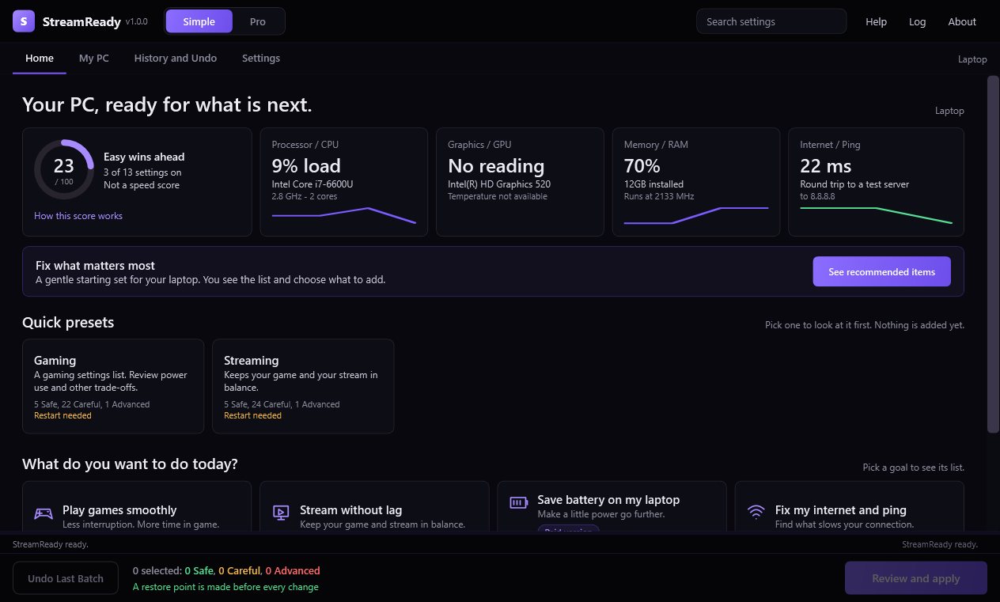
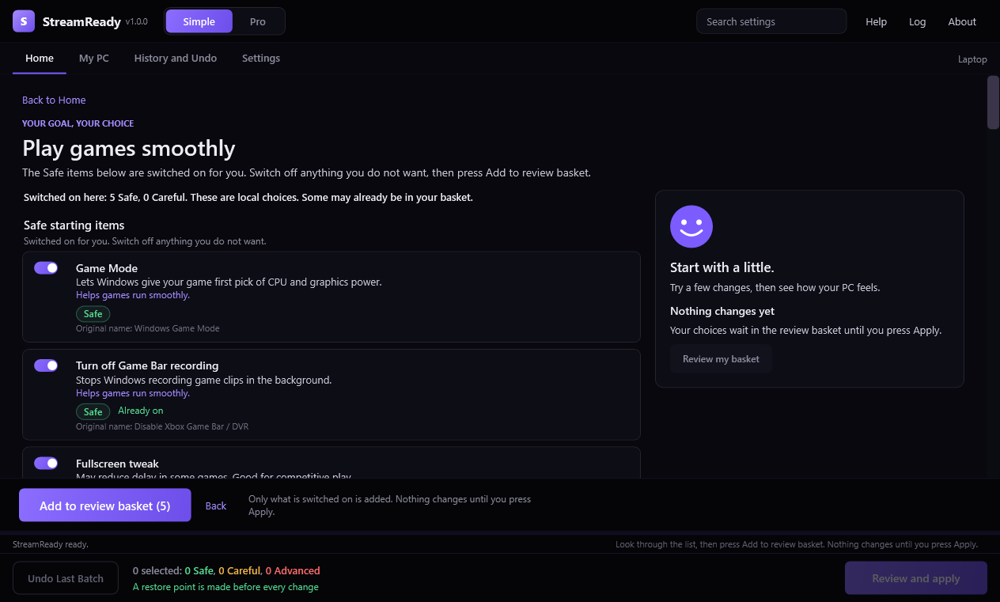
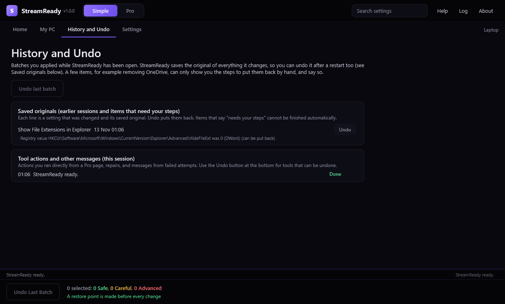
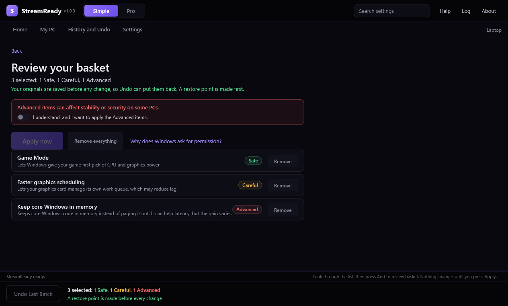
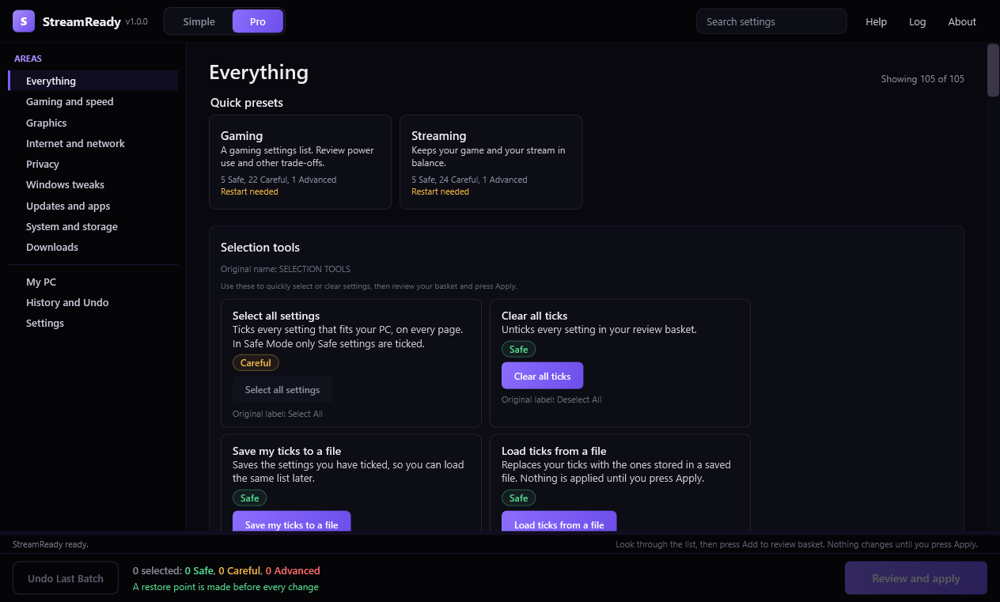
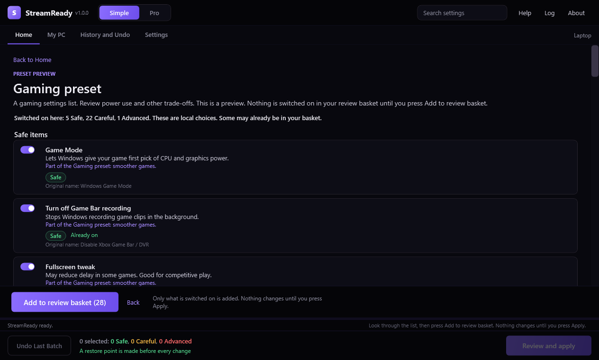
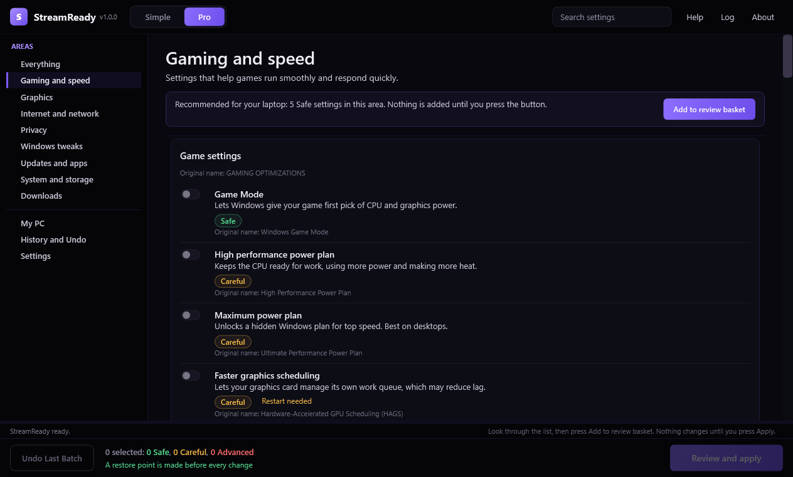

# StreamReady (Open Source Edition)

StreamReady is a Windows optimisation toolkit for gamers and streamers. It is a single GUI with 100+ settings across gaming performance, privacy, networking, and system settings, plus GPU vendor-specific tuning for Nvidia and AMD. Pick what you want, review your selection, and apply it in one click.



## The new look

StreamReady opens in **Simple** view on a fresh install, with a short welcome the first time. A **Pro** view is one click away for people who want every setting:

- **Simple**: a Home page with a setup score, live CPU / GPU / RAM / ping tiles, a **Quick presets** row (Gaming and Streaming) and goal tiles (Play games smoothly, Stream without lag, Fix my internet and ping, Speed up and clean my PC, Protect my privacy, Fix a problem). A goal or preset first opens a preview page: every setting is a row with a switch, a plain reason, a Safe / Careful / Advanced badge and its original name. Safe items start switched on. Careful and Advanced items are listed too: on a preset page they start switched on (outside Safe Mode) so you can see the whole list, and you can switch any of them off; a goal page starts only the Safe items on. Nothing reaches your review basket until you press Add to review basket, and an Advanced item still needs the "I understand" tick before Apply. Nothing is applied until you press Apply in the review basket.
- **Review basket**: see exactly what you picked before anything changes. Advanced settings need an extra "I understand" tick. Nothing is applied until you press Apply.
- **What changed** after every Apply, with an Undo for each setting, plus **History and Undo**.
- **Pro**: one navigation of areas on the left: Everything (a searchable list of all 105 settings with filters and your quick presets), Gaming and speed, Graphics, Internet and network, Privacy, Windows tweaks, Updates and apps, System and storage, Downloads, My PC, History and Undo, and Settings. Every setting and every tool sits inside its area with a plain title, a one-line description, a risk badge, an "Applies immediately" tag for tools that act at once, and its original name in small grey text. Search (top bar or Ctrl+K) finds areas, tools and settings.
- **Safe Mode**: only Safe settings can be switched on, and tools that act immediately and are not Safe are locked. **Larger text**, a **Jargon Buster** glossary and a **My PC** page are included.
- **Undo that restores your original value, also after a restart**: before it changes a setting, the app saves the original (whether a value existed and what it was, services, power plans, adapters, features and more) in a protected folder, and Undo puts exactly that back, even after you close the app or restart Windows. A few things cannot be undone, and the app says so before it starts: see **What Undo covers and what it cannot** below.









A preset preview and a Pro area page:





## Safety first

Most tweak tools ask you to trust them. StreamReady is built so you don't have to:

- **A restore point is tried before each batch of settings.** It can fail (Windows limits how often it makes one, or System Restore may be off), and the app says so. It is a last resort, not the way to undo one setting; Undo uses the saved originals. Tools that act immediately (marked "Applies immediately") do not go through the basket and do not make a restore point; they have their own recorded originals where that is possible, and some things cannot be put back (see the grades below).
- **Undo that survives a restart.** "Undo Last Batch" reverses exactly what the last Apply changed, and History and Undo lists saved originals from earlier sessions with their own Undo buttons.
- **Everything is logged.** Every change and every undo is written to a log file you can read.
- **High-risk tweaks are off by default** and clearly labelled.
- **Nothing is hidden.** The full source is here, and every tweak is documented in [`docs/TWEAKS.txt`](docs/TWEAKS.txt).

## What Undo covers and what it cannot

Both editions of StreamReady use the same Undo engine. Before a setting is changed, the app saves its original state in a protected folder (C:\ProgramData\StreamReady-OSS\undo, next to the folder the paid edition uses but never shared with it), so Undo keeps working after you close the app or restart Windows. "Undo Last Batch", the Undo buttons on the results page and the Undo buttons under History and Undo all use these saved originals. If StreamReady cannot save the original of a setting exactly, it does not change that setting and says so.

How to read the grades below:

- **Exact**: the bounded setting the tweak changes is saved and put back, and the result is read back and checked. This was tested with fixtures and mocks and on one test PC, not in a lab on every kind of hardware.
- **Partly (non-exact)**: the main setting is put back, but something around it is not (a restart is needed, a program has to be reopened, a download stays installed, or only a subset is covered). The note says what to check.
- **Manual**: the app cannot do it by itself. It keeps the item in History with the steps until you press "I did these steps". It never says "put back" for a manual item.
- **Cannot be undone**: deleted or transient data and external repairs. The limit is stated before the action starts and you are asked to confirm.

Rules that apply to everything:

- Two changes on the same setting are undone newest first. If you undo the older one first, StreamReady names the newer one and offers to undo both in the right order.
- A saved original belongs to the Windows account that made it. Another account cannot restore it, and an old record that is not tied to an account is kept for you to review, not guessed.
- If the list of saved originals is damaged, or its folder is not safe, StreamReady stops and says so instead of making changes it could not undo. History offers "Start a new undo list" (the damaged file is kept).
- If an adapter is unplugged when you press Undo for DNS, its saved original is kept: reconnect it and press Undo again, or choose "Give up on this".
- A saved original that this version cannot use is kept and shown in History with a button to discard it (a copy is kept). Applying that setting again is blocked until you decide.
- A program that a tool installed is removed by Undo only when the install can be proven to be this tool's own. Otherwise Undo gives you the steps to remove it yourself.
- The restore point is separate and is never deleted by Undo.

### Settings

| Setting | Grade | What you still do by hand |
|---|---|---|
| All registry-only tweaks (Game Mode, Faster windowed games, privacy and Explorer settings and the other registry rows) | Exact | Nothing. A value that did not exist is removed again. |
| Send game data right away, Send network data instantly | Exact | Nothing. |
| Network card: send faster | Exact | Nothing. Connections opened while it was on are not changed. |
| Network card: react to every packet, Wired network: no power-saving dips | Partly | The property is chosen by its display name; check it in the adapter settings if a driver renamed it. |
| Network card never sleeps | Exact | Restart if Windows asks. |
| Turn off IPv6 | Exact | Nothing (binding flags on the adapters that were captured). |
| Turn off Teredo tunnelling | Partly | Both stores are saved. Check the Teredo state if the network misbehaves. |
| Sharper Windows timer | Exact | Nothing. |
| Skip scanning game folders | Exact | Nothing. Only the entries the tweak added are removed. |
| NVIDIA game profile | Cannot be undone for now | Marked "Temporarily unavailable: undo for this tweak has not been verified on real NVIDIA hardware yet." |
| Remove OneDrive, Classic Photo Viewer | Manual | Follow the steps on screen (reinstall OneDrive, choose the default photo app). |
| Stop Superfetch, Calm background services | Exact | Nothing normally. If a saved dependent service cannot be restored, the named service is shown. |
| Stop sending usage data, Stop NVIDIA data collection, Stop AMD data collection | Exact | Nothing normally. |
| High performance power plan | Exact | Nothing if your original plan still exists. |
| Maximum power plan | Partly | Check Power Options for a copy this tweak made and remove only that extra copy if you do not want it. |
| Keep USB devices awake, Keep all CPU cores awake, Keep PCIe parts awake | Partly | The effective value is put back; the original "inherited from the plan" state becomes an explicit value. Restart where noted. |
| Turn off hibernation | Partly | Free disk space if Undo is refused, then retry. A lost hibernation file cannot be rebuilt. |
| Stop memory squeezing | Exact | Restart Windows if asked. |
| Steadier frame timing (boot settings) | Exact | Restart. If the boot entry guard refuses, check the saved boot entry before any manual step. |
| Turn off VBS (Hyper-V layer) | Partly | Restart; component downloads may be needed; firmware locked VBS has to be changed in firmware settings. |
| Stop PowerShell 7 data | Exact | Reopen PowerShell 7 or sign out and in. |
| NVIDIA and AMD graphics settings (lowest-delay mode, keep video memory awake, top speed, texture filtering, Anti-Lag+, graphics sleep, image sharpening) | Partly (image sharpening and lowest-delay mode: Exact) | Restart games or the driver. After a driver update an old value may need your review; the saved value is shown. These are refused when no matching graphics device is found. |
| Classic right-click menu, Hide Home in Explorer | Partly | Sign in as the same Windows account, then restart Explorer. Custom ownership or permissions on those keys are not restored. |

### Buttons and tools

| Tool | Grade | What you still do by hand |
|---|---|---|
| Change DNS (Cloudflare, Google, Quad9, OpenDNS, fastest, back to automatic) | Exact | Reconnect an unplugged adapter and press Undo again, or give it up in History. |
| Reset network | Partly | Only DNS is saved. Other parts of the reset are done by hand. |
| Winsock reset, Flush DNS, Clean temp files, Clear shader cache, Disk Cleanup, Process idle tasks, Release standby memory, SFC and DISM repair, Fix winget, USB polling download | Cannot be undone | Deleted or transient data and external repairs cannot be brought back. The limit is shown before the action. |
| Create restore point | Kept | Undo never deletes a restore point. Creating one may switch System Restore on for drive C:, and that stays on. |
| Windows Update: Default, Security only | Exact | Restart where asked. |
| Windows Update: Disable | Partly | Dependent services and policies set by other tools are not covered. |
| Reset Windows Update cache | Partly | Four service originals are restored. Deleted update folders are not (Windows rebuilds them). |
| Enable and Disable OpenSSH Server | Partly | Check the SSH feature, credentials and the firewall rule afterwards. |
| Setup and Disable Autologin | Partly | The stored password cannot be saved. If the old password cannot be put back, automatic sign-in is switched OFF and you enter your password again. An unknown state is manual. |
| Disable startup program, graphics preference per app | Exact | Nothing (for the Windows account that made the change). |
| Set max refresh rate | Partly | The primary display only. |
| Storage adaptive tweaks | Partly | Registry and service subset; restart. |
| Wi-Fi gaming mode | Partly | The adapter is chosen again by name when you press Undo. |
| F8 boot menu, registry backup, Intel hybrid CPU priority | Exact | Restart where the tweak says so. |
| Pagefile: system managed | Partly | Restart; there is a free-space guard. |
| AMD V-Cache | Partly | Registry subset; restart. |
| Install WSL, Hyper-V, Windows Sandbox, .NET, NFS, legacy media | Partly | Only the Windows feature state is saved. Downloads, data and distributions stay; restart. |
| Install apps and the download tools (HWiNFO, Afterburner, GPU-Z, CPU-Z, CrystalDiskInfo, Process Lasso, CapFrameX, TreeSize, Equalizer APO, LatencyMon) | Partly | A package is removed only when its install is proven to be this tool's own, otherwise you uninstall it yourself. Upgrades and your data are not rolled back. |

### What has and has not been tested

The saved-original engine, every kind of setting it covers and the History page were tested with automated suites (fixtures, mocks and throwaway registry keys) and with the app's own self-test, and the window was run on one Windows 11 PC. They were NOT tested in a lab on every kind of hardware: real winget installs and uninstalls, real unplugged adapters, real boot entry changes, real NVIDIA and AMD drivers, a Windows account joined to a work or school directory, and a stored sign-in password were all checked with mocks only. If something is important to you, create your own restore point first.

## Benchmarks

Before and after CapFrameX results from the author's own PC will be added here. No FPS gains are promised. Results vary from system to system, so test on your own machine and keep what helps.

---

## ⚠️ Before you run this

StreamReady **changes real Windows settings**: registry values, services, and sometimes Windows features. Please read this before applying anything:

- **It runs as Administrator.** It needs this to make system-wide changes, and it will explain this in one line before Windows asks you to approve it.
- **It tries to create a Windows System Restore point before each batch of changes.** Windows can refuse (System Restore may be off, or a recent point exists), and the app says so. It is a last resort. Undo uses the saved originals. Turn System Restore on via Windows' "Create a restore point" if you want this extra safety net.
- **Almost every tweak can be undone.** Use "Undo Last Batch" to reverse exactly what the last Apply did. A handful of items cannot be put back automatically (deleted data, external repairs, removing OneDrive); the app tells you before it starts and keeps the steps in History.
- **A handful of tweaks are genuinely high-risk** (adding Windows Defender exclusions for game folders, disabling VBS/Hyper-V, disabling CPU security mitigations, enabling remote SSH access). These are never pre-selected and are clearly labelled. see [`docs/TWEAKS.txt`](docs/TWEAKS.txt) for exactly what each one does and how risky it is before you tick it.
- **Use at your own risk.** This is free, open source software provided as-is (see [LICENSE](LICENSE)). There's no warranty, and you're responsible for reviewing what you apply to your own PC.

## Known limits

This is a first public release. Things to know before you rely on it:

- **Some undo steps are partly manual or not exact.** OneDrive removal and the classic photo viewer need your steps, a stored sign-in password is never saved, cleanup tools and Winsock reset cannot be undone, and some network, boot, feature and graphics settings need a restart or a check afterwards. The full list is in **What Undo covers and what it cannot** below. The restore point is your safety net for anything the list marks as not exact.
- **A tweak that fails halfway** is rolled back at once when the original was saved. If the rollback cannot finish, the saved original is kept in the engine's store (`C:\ProgramData\StreamReady-OSS\undo`) and shown in History so you can undo it from there. The file `%LOCALAPPDATA%\StreamReady\undo_records_oss.json` is only an import path for records written by an older recovery routine: this edition does not normally create it. If it exists, the engine imports its usable records once at the next start and sets the file aside (renamed with `.imported` and a time stamp); records that cannot be validated are left in it.
- **Saved originals live in `C:\ProgramData\StreamReady-OSS\undo`.** They survive closing the app and restarting Windows. They are tied to the Windows account that made the change, and the folder is checked every time it is used. This edition and the paid edition keep their records in different folders and never restore each other's records.
- **Restore points are not guaranteed every time.** Windows limits how often it creates one, so an older recent point may be the one you get.
- **Run it from your own administrator account.** Tweaks that change your user settings (mouse, keyboard, Explorer and so on) apply to the account that approves the Administrator prompt. If you normally use a standard account and approve with a different admin account, those changes land on the admin account.
- **The window can freeze during long jobs** such as the corruption scan, downloads and app installs. It is working; wait for it to finish.
- **"Select all" (Pro > Everything) ticks every setting that fits your PC,** including the high-risk ones, unless Safe Mode is on (then it ticks only Safe settings). Review the list before you Apply.
- **Not yet tested end to end on a spare machine:** the tool downloads (HIDUSBF and Nvidia Profile Inspector), the Timer Resolution task, the Defender exclusions and the Windows Update buttons were recently reworked. They were checked by code review and by testing their helper functions, but not yet run start to finish on a clean PC. Try those on a spare machine first.

## How to run it

### From a release (recommended)

1. Download the latest release zip from the [Releases](../../releases) page.
2. Right-click the zip > **Properties** > tick **Unblock** (at the bottom) > OK. This removes Windows' "downloaded from the internet" flag so it runs cleanly.
3. Extract the zip, then double-click **Run StreamReady.bat**. (Or right-click `src\StreamReady.ps1` and choose **Run with PowerShell**.)
4. Approve the Administrator prompt when it appears.

### From source

```powershell
git clone https://github.com/StreamReadyDev/streamready-oss.git
cd streamready
powershell -NoProfile -ExecutionPolicy Bypass -File src\StreamReady.ps1
```

## A note on SmartScreen / antivirus warnings

StreamReady is an unsigned PowerShell script. Code signing certificates cost money, and this project doesn't have one. Because of that, Windows SmartScreen or your antivirus may flag it as "unrecognized" the first time you run it. This is expected for any unsigned tool that changes system settings, not a sign that something is wrong.

To verify you have the exact files this project published (and that nothing has been tampered with), check their SHA256 hashes against the ones on the release page. Two hashes are published for each release: one for the zip you download and one for the script inside it. Run these in PowerShell:

```powershell
# 1. The zip, before you extract it (run this where you saved it)
Get-FileHash StreamReady-OSS-v1.0.0.zip -Algorithm SHA256

# 2. The script, after you extract the zip (run this inside the extracted folder)
Get-FileHash src\StreamReady.ps1 -Algorithm SHA256
```

Compare each result with the matching line in `SHA256SUMS.txt` (attached to the [Releases](../../releases) page, and repeated at the bottom of the release notes) for the version you downloaded. Each result must match its line exactly, letter for letter. If either one differs, do not run it: download it again, and if it still differs, open an issue. The hashes are not written in this README on purpose, because the README is inside the zip and the zip's hash would change every time the README did.

If you run from source (a git clone), the script hash of your copy is expected to differ once you change anything, so only compare it for a release download.

## What it does

See [`docs/USER-GUIDE.txt`](docs/USER-GUIDE.txt) for a plain walk through the app, and [`docs/TWEAKS.txt`](docs/TWEAKS.txt) for the full list: every tweak, what it actually changes, its risk level, and how its undo works. Each setting has a Safe, Careful or Advanced badge in the app (the full map is at the top of the tweak list in the docs). In short: Gaming (Gaming and Streaming presets), Privacy, System, Network, GPU vendor tweaks, Timer Resolution control, and a Downloads area for common free tools (HWiNFO, GPU-Z, and more via `winget`).

## Supported Windows versions

Windows 10 and Windows 11. Some individual tweaks are version-specific. The app checks for this where relevant and will tell you if a tweak doesn't apply to your build.

## Contributing

See [`CONTRIBUTING.txt`](CONTRIBUTING.txt). Short version: every new tweak needs a working undo, a risk-appropriate default, and an entry in `docs/TWEAKS.txt`.

## Security

Found a security issue? Please don't open a public issue. See [`SECURITY.txt`](SECURITY.txt) for private reporting instructions.

## StreamReady (paid edition)

This open source edition is the smaller, free version of StreamReady. The paid edition adds, on top of everything here:

- Competitive, Advanced and Laptop presets
- Goal pages for saving laptop battery and for tuning one specific game
- The Game profiles and Hardware areas: MSI / IRQ management, per-game configs (Call of Duty BO6, Valorant, Fortnite, CS2) and the CPU Core Optimizer
- A guided first run (a PC check and a short plan, listed item by item)
- Report a problem (saves your log to a text file for support)
- Licence-backed support and updates

In the app, Help > "What the paid version adds" shows the same list. The free edition never shows pop-ups about it.

Get the paid edition: https://streamready.gumroad.com/l/kwkre

## Licence

MIT. See [LICENSE](LICENSE). Free to use, modify, and redistribute.
